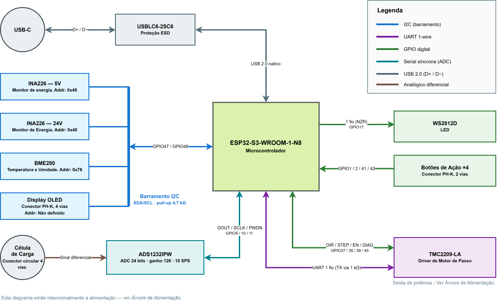
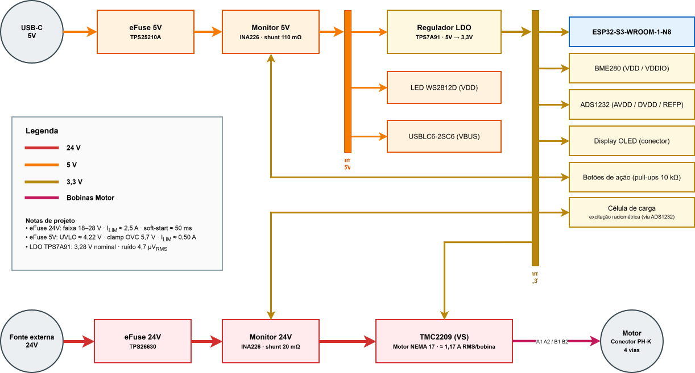
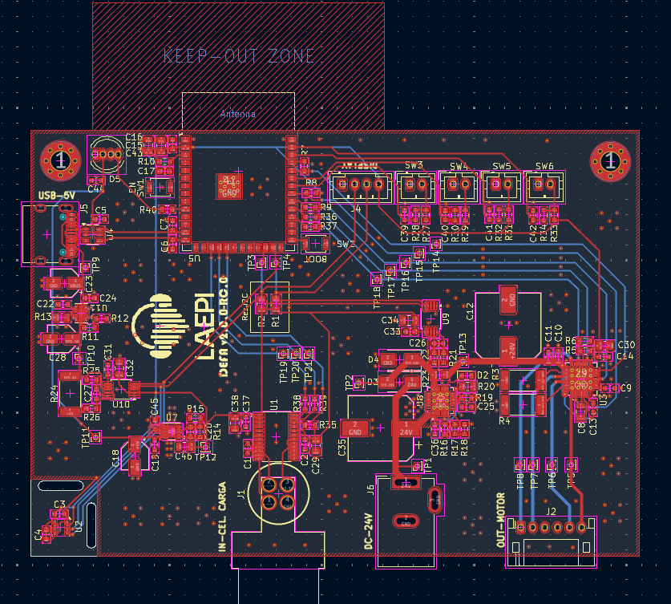
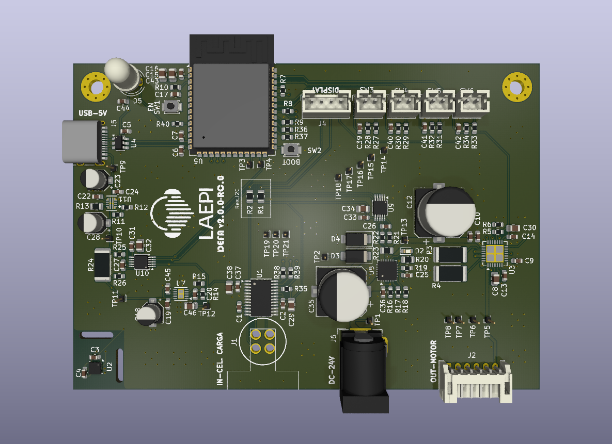
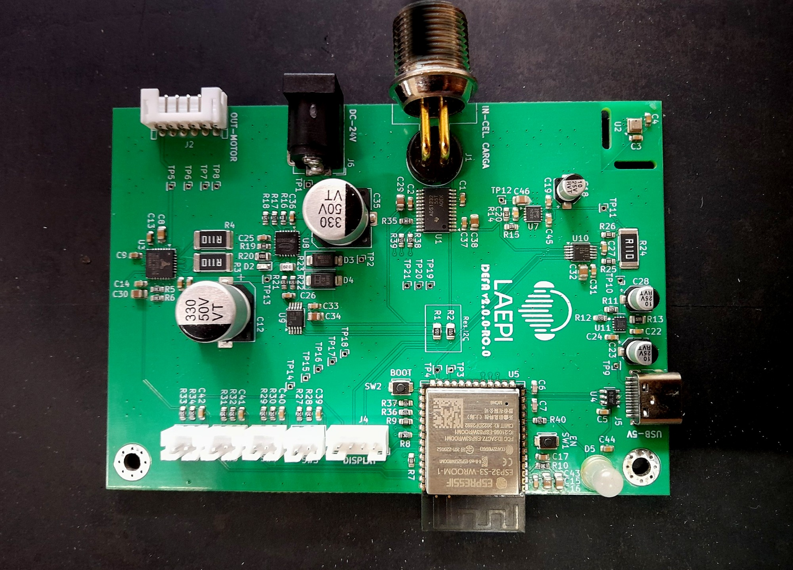
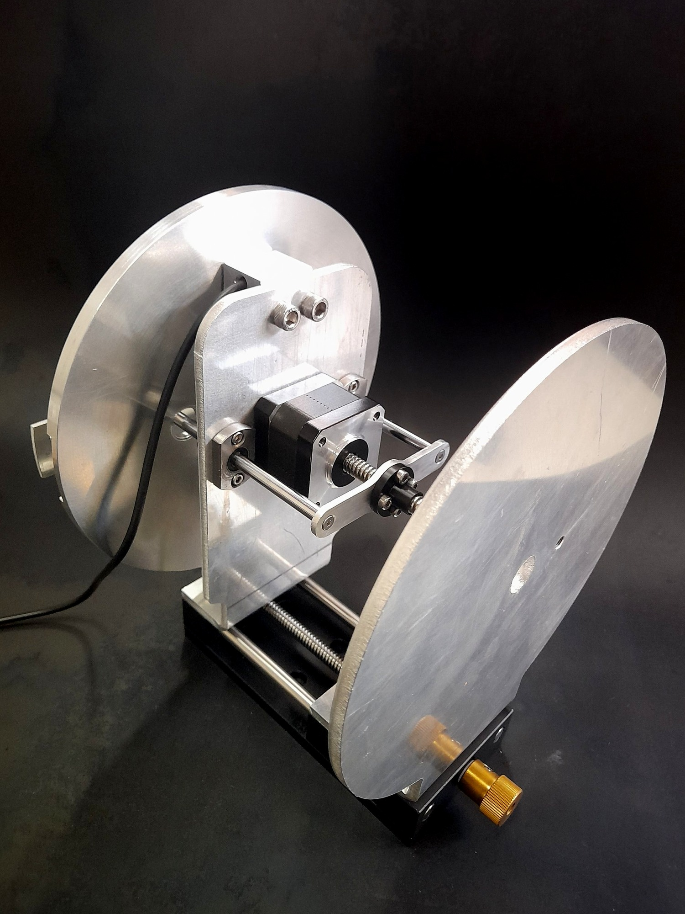
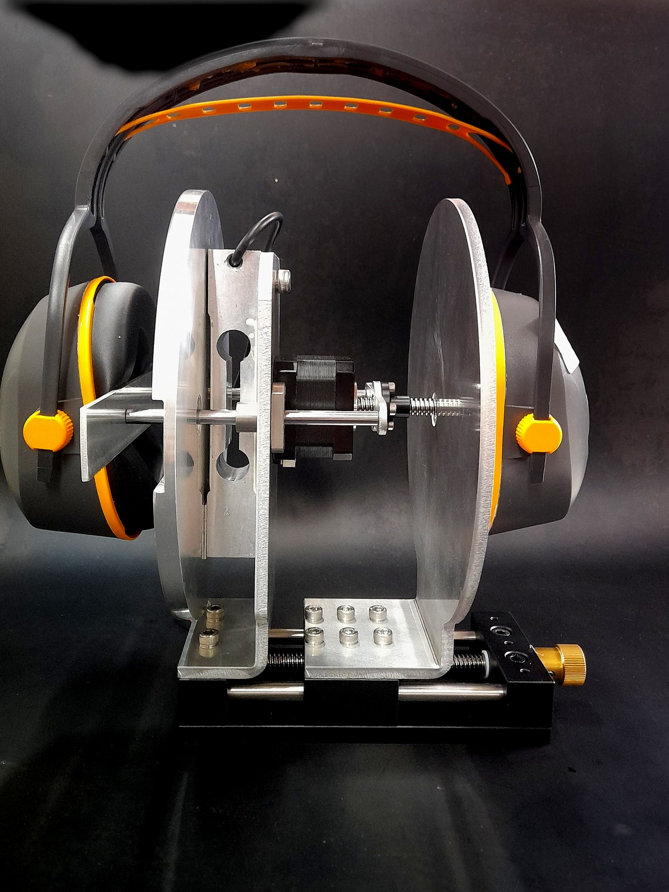
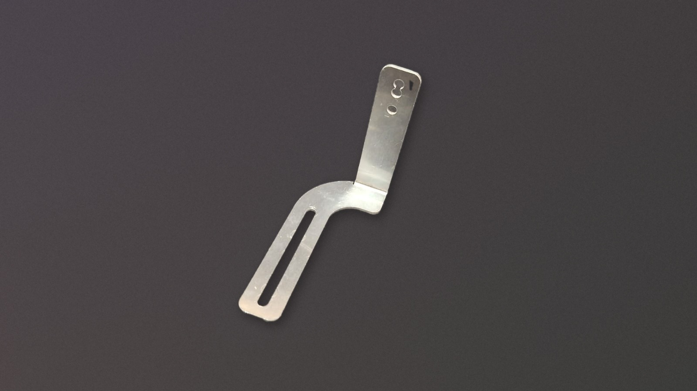

# Etapa 3

Esta etapa passa do projeto para o hardware. O roteamento da PCI foi concluído e a placa fabricada e recebida, a estrutura foi montada e validada, e os ensaios de bancada confirmaram o funcionamento da placa, do motor e da cadeia de medição. O case da PCI teve a primeira versão reprovada na fabricação, e a segunda, redesenhada para o processo, está em produção.

## Desenvolvimento

### Diagramas de blocos completos

Os diagramas de comunicação e de alimentação foram consolidados na Etapa 2 e permanecem válidos. São reproduzidos aqui para referência.

#### Diagrama de comunicação

#### Diagrama de alimentação

### Finalização do projeto da PCI e envio para fabricação

A etapa anterior terminou no esquemático. Nesta etapa o roteamento foi concluído e a placa enviada para fabricação.

| Característica | Valor |
| :--- | :--- |
| Camadas | 2 |
| Dimensões | 100 × 70 mm |
| Espessura | 1,6 mm |
| Fabricante | JLCPCB |

Todo o circuito foi roteado com trilhas de 0,2 mm, com exceção do barramento de 24 V, em 1 mm, e das trilhas que levam às bobinas do motor, em 0,5 mm. Larguras dimensionadas para a corrente de operação. As duas camadas têm malha GND.

O sensor de temperatura e umidade ficou no canto oposto ao driver do motor, isolado por dois rasgos na placa e sem malha de cobre ligando-o ao restante: assim ele mede o ambiente do ensaio e não o aquecimento da própria placa, que é a condição exigida pela norma. A antena do módulo ESP32 ficou projetada para fora da borda da placa, como recomenda o datasheet da Espressif, e o conector da célula de carga foi posicionado junto ao conversor A/D, encurtando o trajeto do sinal diferencial.

Antes da geração dos arquivos de fabricação foram executadas as verificações de regras elétricas (ERC) e de regras de projeto (DRC).

#### Layout da PCI

#### Vista 3D do KiCad

#### Placa confeccionada

### Montagem e ajuste da estrutura

As peças da estrutura foram desenhadas na Etapa 2 e enviadas para a Metal Porto, em Palhoça, empresa de corte e dobra de chapas de alumínio. Nesta etapa elas foram recebidas e validadas pela montagem: verificou-se o encaixe entre as peças, a rigidez do conjunto e o atendimento aos requisitos.

A estrutura foi validada quase por completo. A exceção é o suporte do pino de apoio para protetores acoplados a capacete. A peça é fixada ao suporte L deslizante e sustenta um pino centralizado na estrutura, sobre o qual o capacete se apoia, com ajuste de altura. Por ser uma chapa de 2 mm dobrada em L, ficou flexível demais e não mantém o capacete imóvel durante o ensaio. A peça será refeita com chapa mais espessa.

#### Estrutura montada

#### Estrutura com o protetor posicionado

#### Suporte de pino reprovado

## Testes

O registro completo da validação está em [Testes de Hardware](Testes_de_Hardware.md), com os códigos em [`Codigos/`](Codigos/). Instrumentos: multímetro Fluke 289 e osciloscópio Rigol DS4034.

## Referências

Norma **EN 13819-1:2020** via _BSI Standards Publication_: [EN 13819-1-2020 1.pdf](https://github.com/user-attachments/files/32043709/EN.13819-1-2020.1.pdf)
