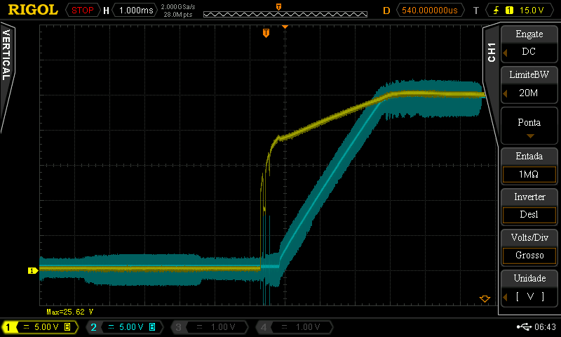
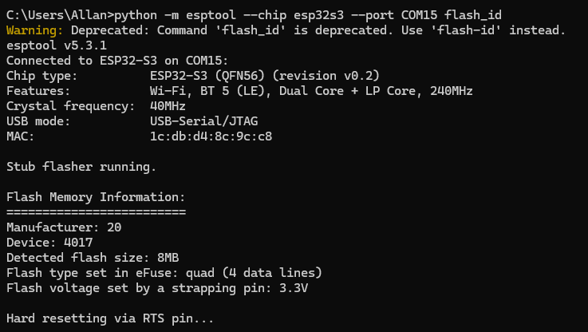

# Testes de Hardware

Validação da placa de controle (ESP32-S3-WROOM-1-N8) após a montagem, na ordem: verificações
com a placa desenergizada, medição das tensões, validação do microcontrolador e teste
funcional de cada periférico. Os códigos estão em [`Codigos/`](Codigos/).

Instrumentos: multímetro **Fluke 289** (50 000 contagens, ±0,025 % + 2 dígitos; os valores
mínimo/médio/máximo vêm da função de registro do próprio instrumento) e osciloscópio
**Rigol DS4034**.

<!-- TODO: data dos ensaios, revisão da placa e identificação da unidade. -->

---

## 1. Continuidade (placa desenergizada)

Verificação de curtos entre os barramentos e destes para o GND, antes de qualquer
energização.

| Verificação | Resultado |
| :--- | :--- |
| 24 V ↔ 5 V ↔ 3,3 V (entre si) | Sem continuidade |
| 24 V, 5 V e 3,3 V ↔ GND | Sem curto |

Aprovado. Os barramentos estão isolados entre si e nenhum apresenta curto para o terra.

---

## 2. Alimentação

### 2.1. Barramento de 5 V e 3,3 V

Placa alimentada apenas pelo USB-C.

| Ponto | Posição | Mín. (V) | Méd. (V) | Máx. (V) |
| :--- | :--- | ---: | ---: | ---: |
| TP9 | Após o conector USB-C | 5,0509 | 5,0521 | 5,0580 |
| TP10 | Após o eFuse de 5 V | 5,0501 | 5,0518 | 5,0549 |
| TP11 | Após o shunt do INA226 | 5,0402 | 5,0450 | 5,0550 |
| TP12 | Saída do LDO (3,3 V) | 3,2846 | 3,2847 | 3,2847 |

Aprovado. O barramento de 5 V está dentro da janela do eFuse (UVLO 4,22 V, clamp 5,7 V) e a
saída do LDO ficou em 3,2847 V contra 3,28 V de projeto — desvio menor que 0,1 %.

A tensão de 3,3 V que chega a cada CI foi verificada; o pior caso é o TMC2209, com 3,2763 V
(queda de 8,4 mV, ou 0,26 %), coerente por ser o componente mais distante do LDO.

<!-- TODO: completar com as tensões medidas nos demais CIs e repetir com o motor energizado. -->

### 2.2. Barramento de 24 V

Placa alimentada apenas pela fonte externa de 24 V.

| Ponto | Posição | Tensão (V) |
| :--- | :--- | ---: |
| TP1 | Após o conector DC | 24,427 |
| TP2 | Após o eFuse de 24 V | 24,426 |
| TP13 | Após o shunt do INA226 | 24,426 |

| Corrente | Valor |
| :--- | ---: |
| Pico na partida | 0,208 A |
| Regime (driver desabilitado) | 10,5 mA |

Aprovado quanto à tensão: 24,43 V no centro da faixa configurada (UVLO 18,0 V, OVP 28,0 V).
Nessa corrente a queda no shunt seria de 0,21 mV, abaixo da resolução do multímetro — por
isso o valor do shunt só pôde ser validado depois, com o motor acionado (ver 4.5).

O valor de pico da partida foi medido com multímetro e não representa o pico real de um
transitório de milissegundos; a medição precisa ser refeita com osciloscópio.

Ao conectar a fonte já energizada houve **faiscamento no conector** — ver achado 6.1.

### 2.3. Rampa de partida do eFuse de 24 V



**Reprovado.** A rampa mediu ≈ 4 ms, contra os ≈ 50 ms de projeto para o capacitor de 100 nF
no pino dVdT. Ver achado 6.2.

---

## 3. Microcontrolador

```text
python -m esptool --chip esp32s3 --port COM15 flash_id
```



Aprovado. A saída confirma o ESP32-S3 na variante N8 (8 MB de flash), o modo
`USB-Serial/JTAG` — que valida o trajeto D+/D- pelo USBLC6-2SC6 — e a tensão de VDD_SPI em
3,3 V definida pelo pino de strapping, como previsto no projeto.

---

## 4. Periféricos

Testes feitos com sketches individuais na Arduino IDE, um por periférico.

### 4.1. Barramento I2C

**Código:** [`Codigos/i2c_scan.ino`](Codigos/i2c_scan.ino)

Varredura de endereços em SDA = GPIO47 e SCL = GPIO48.

| Endereço | Dispositivo |
| :--- | :--- |
| `0x40` | INA226 de 24 V |
| `0x45` | INA226 de 5 V |
| `0x76` | BME280 |

Aprovado. Os três responderam nos endereços definidos por hardware. O display OLED não
estava conectado.

### 4.2. LED indicador WS2812D

**Código:** [`Codigos/ws2812d_teste.ino`](Codigos/ws2812d_teste.ino)

Sequência de cores em GPIO17. Aprovado — todas as cores corretas e na ordem esperada.

### 4.3. Botões de ação

**Código:** [`Codigos/botoes_teste.ino`](Codigos/botoes_teste.ino)

Leitura de B1–B4 (GPIO41, 42, 2 e 1) sem pull-up interno, já que o pull-up é externo.
Aprovado — os quatro respondem em lógica ativa em nível baixo, sem acionamentos falsos.

### 4.4. BME280

**Código:** [`Codigos/sensores_i2c.ino`](Codigos/sensores_i2c.ino)

Leitura: 24,43 °C · 64,8 %RH · 1015,8 hPa. Aprovado.

<!-- TODO: comparar temperatura e umidade com um instrumento de referência; o sensor está na PCI e sofre autoaquecimento. A pressão é absoluta: conferir contra a altitude local. -->

### 4.5. INA226 (5 V e 24 V)

**Código:** [`Codigos/sensores_i2c.ino`](Codigos/sensores_i2c.ino)

Faixas informadas à biblioteca: 0,7 A / 110 mΩ para o barramento de 5 V e 4,0 A / 20 mΩ
para o de 24 V. Leituras tomadas com o motor em operação (ver 4.7):

| Condição | 5 V | 24 V |
| :--- | :--- | :--- |
| Motor girando | 5,059 V · 48,2 mA · 266,2 mW (shunt 5,775 mV) | 24,404 V · 165,2 mA · 4030 mW (shunt 3,290 mV) |
| Motor parado (com hold) | 5,059 V · 48,1 mA · 260,0 mW (shunt 5,650 mV) | 24,423 V · 81,0 mA · 1990 mW (shunt 1,663 mV) |

Aprovado:

- **Tensões conferem entre si e com o multímetro.** 5,059 V contra 5,0518 V em TP10
  (0,14 %) e 24,423 V contra 24,426 V em TP13 (0,01 %).
- **Shunt de 24 V validado.** A queda de 3,290 mV sobre 20 mΩ dá 164,5 mA, contra 165,2 mA
  reportados — 0,4 % de diferença.

### 4.6. ADS1232 (célula de carga)

**Códigos:** [`Codigos/ads1232_taxa.ino`](Codigos/ads1232_taxa.ino) e
[`Codigos/ads1232_leitura.ino`](Codigos/ads1232_leitura.ino)

**Taxa de conversão — aprovado.** Contagem de bordas do DRDY em janelas de 2 s: 16 na
primeira (inclui a acomodação após o reset pelo PWDN) e 20 nas quatro seguintes, ou seja
10,0 SPS — a taxa definida com o pino SPEED aterrado. Consequência para o firmware: após
acordar o ADC, descartar as leituras do primeiro meio segundo.

**Achado — o pulso de instrução.** Integrada ao firmware completo, a leitura passou a oscilar
de forma incompatível com a célula em repouso, com saltos periódicos para valores muito acima
da faixa. A medição dos intervalos entre conversões localizou a causa no software, e não no
circuito: no ADS1232 os pulsos de SCLK além dos 24 de dados instruem o chip sobre a próxima
conversão. Sem o 25º pulso, o conversor não libera o DRDY; a rotina dispara uma segunda
leitura, cujos pulsos caem na combinação que pede calibração de offset, e o chip fica oito
ciclos sem entregar dado.

| Medida, antes da correção | Valor |
| :--- | ---: |
| Intervalos curtíssimos | 0,22 ms, em 32 % das leituras |
| Intervalos longos | 801,50 ms, em 31 % |
| Razão longo / período | 8,011 — oito ciclos exatos |
| Taxa efetiva | 3,48 SPS, contra os 10,0 de projeto |

Confirmado por liga-desliga, alternando o número de pulsos em tempo de execução. Isso também
explica por que o teste de taxa acima não acusou erro: ele conta bordas do DRDY sem ler os
dados, portanto não emite pulsos que o chip interprete como instrução. O hardware sempre
esteve correto. Correção: emitir o 25º pulso dentro da mesma seção crítica dos 24 de dados.

**Cadeia de medição — aprovado.** Depois da correção, 247 conversões consecutivas em
100,066 ms ± 0,05 ms, sem anomalia. Célula fixada na estrutura, massa de referência de 500 g,
duas campanhas independentes.

| Medida | Valor |
| :--- | ---: |
| Zero (bancada vazia) | 82 119 contagens |
| Escala | 455,0 contagens/g — 46 393 contagens/N |
| Conferência independente | 453,78 contagens/g (0,26 %) |
| Ruído | 0,09 g |
| Ocupação da escala nos 40 N do ensaio | 23 % da faixa de 24 bits |
| Deriva sob carga de 500 g | 1,25 g em 4,5 min |

A deriva sob carga é fluência da célula, normal em célula de viga. É relevante para a
EN 13819-1 (4.4), que manda ler a força 120 s após a soltura: o instante fixo faz todos os
ensaios sofrerem a mesma fluência, o que mantém os resultados comparáveis.

### 4.7. TMC2209 e motor de passo

**Códigos:** [`Codigos/tmc2209_uart.ino`](Codigos/tmc2209_uart.ino) e
[`Codigos/motor_monitoramento.ino`](Codigos/motor_monitoramento.ino)

**UART — aprovado.** Com 24 V desligado:

```text
version: 0x21
IFCNT: 4
DRV_STATUS: 0xC0100000
ot: 0   s2ga/s2gb: 0 0
```

A assinatura `0x21` confirma o driver respondendo no endereço `0b00` fixado por hardware, e o
`IFCNT` mostra que as escritas de configuração também são aceitas — a comunicação de fio
único funciona nos dois sentidos. No `DRV_STATUS`, os bits ativos são `stst` (repouso) e
`stealth`, este último confirmando a partida em StealthChop2 com o pino SPREAD aterrado;
nenhum sinalizador de falha ativo.

**Acionamento — aprovado.** Com 900 mA RMS, 16 micropassos e StealthChop2, o motor girou nos
dois sentidos conforme programado. Consumo nas duas condições registrado em 4.5: o driver
acrescenta 70,5 mA em repouso com corrente de hold e 155 mA girando, sobre os 10,5 mA da
seção 2.2 — 4,03 W de pico, ou 6,6 % do limite de 2,5 A do eFuse.

<!-- TODO: registrar as condições `driver off` e `eixo travado`, e repetir a leitura de UART com 24 V ligado incluindo o registrador GSTAT (bit uv_cp). -->

---

## 5. Resumo e pendências

| Etapa | Resultado |
| :--- | :--- |
| 1 · Continuidade | Aprovado |
| 2.1 · Barramento de 5 V e 3,3 V | Aprovado |
| 2.2 · Barramento de 24 V | Aprovado, com ressalva (6.1) |
| 2.3 · Rampa de partida | **Reprovado** (6.2) |
| 3 · Microcontrolador e USB nativo | Aprovado |
| 4.1 · Barramento I2C | Aprovado |
| 4.2 · LED WS2812D | Aprovado |
| 4.3 · Botões B1–B4 | Aprovado |
| 4.4 · BME280 | Aprovado |
| 4.5 · INA226 ×2 | Aprovado |
| 4.6 · ADS1232 e cadeia de medição | Aprovado — 455,0 contagens/g, ruído 0,09 g |
| 4.7 · TMC2209 e motor | Aprovado |

Pendentes:

- Linearidade e repetibilidade da célula com um segundo ponto de massa conhecida (tara,
  escala, ruído e deriva já caracterizados em 4.6).
- Limiares de UVLO e OVP do eFuse de 24 V e LED de falha (FLT), com fonte ajustável.
- Linha DIAG (StallGuard4), display OLED no conector I2C e botões Reset e Boot.
- Ensaio de aquecimento com o motor em operação contínua.
- Conferência da corrente dos INA226 contra amperímetro externo, em especial no
  barramento de 5 V, cujo shunt ainda não foi validado por medição simultânea.

---

## 6. Achados para a próxima revisão

### 6.1. Capacitor de 330 µF de entrada antes do eFuse de 24 V

O capacitor bulk está no pino IN, fora do alcance da rampa de soft-start, que atua apenas
sobre a saída. Ao energizar com a fonte ligada, sua carga produz faiscamento no conector
(≈ 98 mJ). Sem dano funcional, mas desgasta os contatos.

Ações: mover a maior parte da capacitância para a saída do eFuse, avaliando junto a
supressão de transientes na entrada (menos capacitância aumenta o sobressinal do hot-plug);
enquanto isso, conectar o cabo com a fonte desligada e energizar pela chave.

### 6.2. Rampa de soft-start dez vezes mais rápida que o projeto

Rampa de ≈ 4 ms contra os ≈ 50 ms calculados. Já descartados: limitação do dispositivo (os
4,0 ms do datasheet são o típico para a condição de teste de 10 nF, não um teto), partida
rápida via PGTH (aterrado nesta placa) e valor do capacitor (medido, 100 nF).

Impacto: o pico de corrente na partida passa de ≈ 0,16 A para ≈ 2,0 A, quase 80 % do limite
de 2,5 A do eFuse — margem insuficiente.

Verificações: continuidade do capacitor até o pino dVdT, sondagem do pino durante a partida
(ponta em 10:1), orientação do diodo SS36 e medição da corrente durante a rampa. Com os
quatro canais do osciloscópio, dá para resolver tudo numa única aquisição em disparo único.
